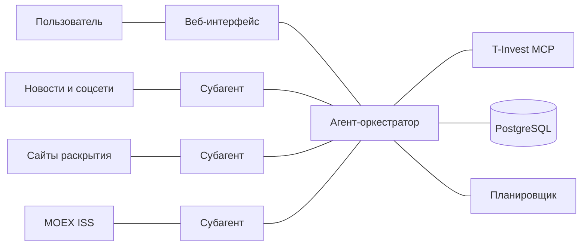

  

<h1 align="center">Инвест-ассистент</h1>

  Проект для «Инвест. Премаркет 2026» от Т-Банка. Неофициальный.

Мы делаем ассистента, который с помощью ИИ-агентов собирает инвестиционный контекст и показывает только ключевое, чтобы инвестор не тонул в потоке новостей, отчетов, котировок, настроений рынка и изменений правил.

## Кейсы использования

- **Аналитика портфеля:** сектора, концентрации, будущие выплаты, перекосы
- **Аналитика перед сделкой:** события по бумаге, портфель после сделки, налоги
- **Еженедельный дайджест:** итоги недели и что ждет портфель дальше
- **Итоги года:** остаток лимита ИИС и способы снизить налог до 31 декабря
- **Пользовательские задания:** «Ассистент, следи за дивидендами Компании А»

Ассистент показывает факты и варианты. Решение и подтверждение сделки остаются за пользователем.

## Архитектура

Оркестратор раздает задачи субагентам, собирает их выжимки в отчет и работает с портфелем через T-Invest MCP. В MVP заявки уходят только в песочницу и только после подтверждения. Модели (Qwen, DeepSeek, Mistral, GigaChat, Alice AI) подключаются через единый OpenAI-совместимый интерфейс.
